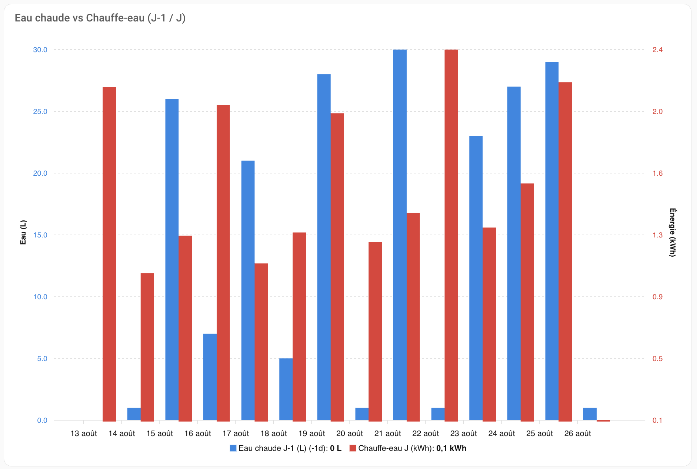
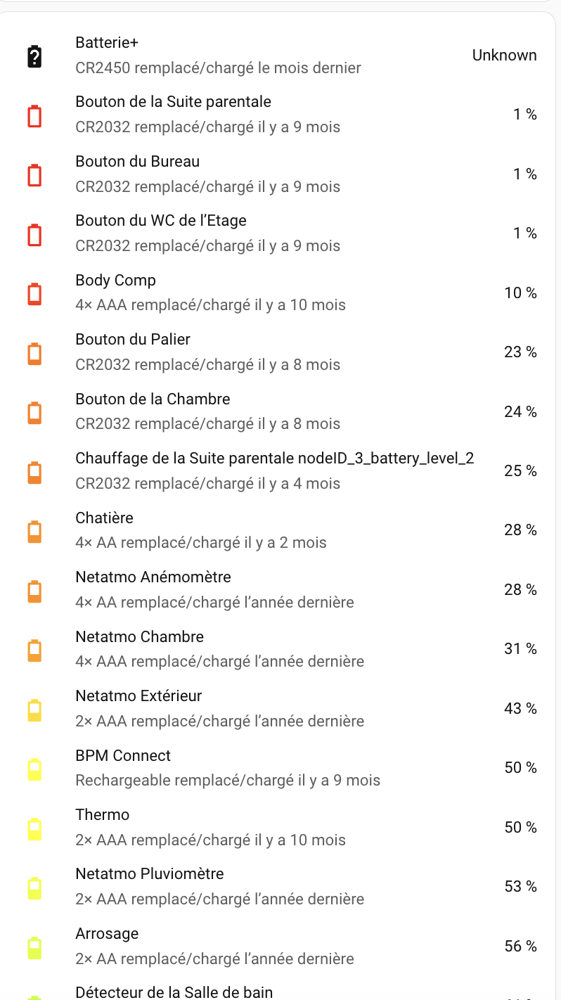
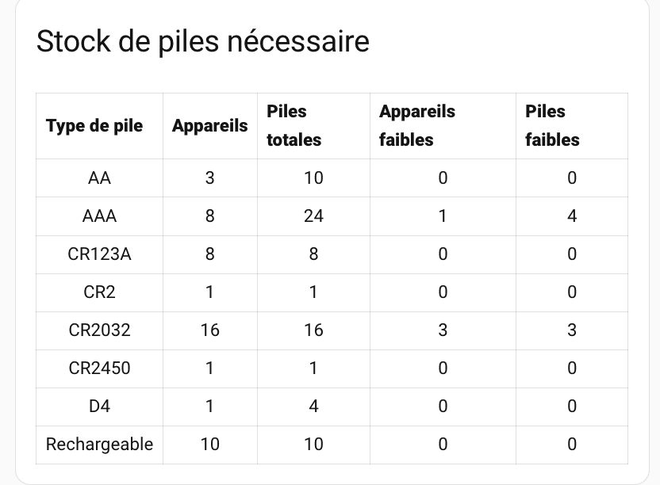
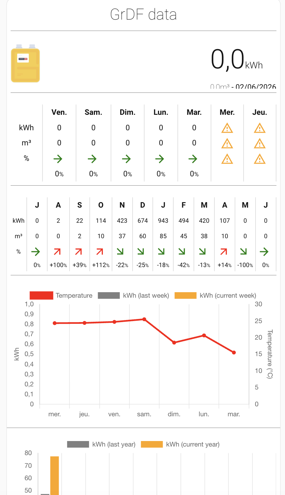
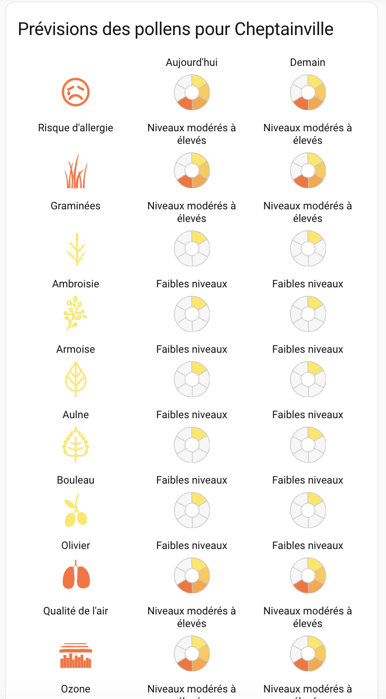
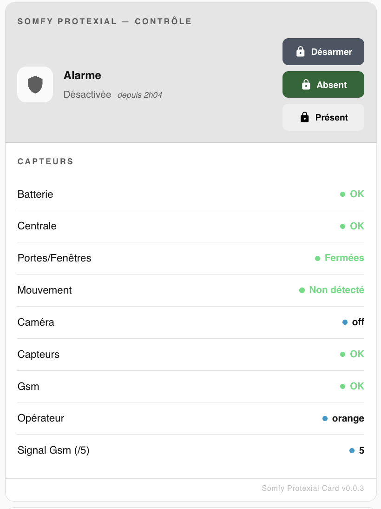
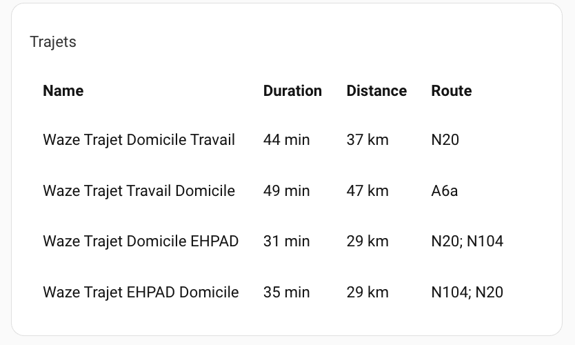

# 🛠️ HACS — Intégrations & Cartes Lovelace

[← Retour README](../README.md)

---

## Intégrations (37)

> 37 intégrations installées, dont 35 configurées (L'eau d'Ile-de-France et PDF Scrape ne le sont pas).

### Alexa Media Player
> [GitHub](https://github.com/alandtse/alexa_media_player) — `domain: alexa_media`

Contrôle des appareils Amazon Alexa via l'API non officielle.

---

### Atmo France
> [GitHub](https://github.com/sebcaps/atmofrance) — `domain: atmofrance`

Qualité de l'air pour les villes françaises depuis Atmo France.

**Configuration :**
- Ville : [Votre ville]

---

### Battery Notes
> [GitHub](https://github.com/andrew-codechimp/HA-Battery-Notes) — `domain: battery_notes`

Suivi des types et dates de remplacement des batteries.

**Utilisation :** Automations `battery_low_notification`, `daily_battery_low_check`, `battery_increased_notification`.

---

### Cork Dork
> [GitHub](https://github.com/BaconWappedBitcoin/ha-wine-cellar) — `domain: wine_cellar`

Suivi de la cave à vin par lecture de codes-barres, avec représentation des étagères.

**Entités :** `sensor.cork_dork_total_bottles`, `sensor.cork_dork_capacity`, un capteur par étagère (1 à 6) et `sensor.cork_dork_refrigerateur`. Carte associée : `custom:wine-cellar-card`.

---

### CoverAutomatic
> [GitHub](https://github.com/slemeur91/CoverAutomatic) — `domain: cover_automatic`

Pilotage automatique des volets, velux et store selon la position du soleil, l'heure, la température et un scénario (`vacation` / `summer` / `winter`). Remplace les anciennes automatisations de gestion des volets et des velux.

**Configuration :** 13 ouvrants (9 volets, 3 velux, store de la pergola) et 10 façades. Le scénario est sélectionné par l'automatisation [`Scénario coverAutomatic`](automations/volets.md). Carte associée : `custom:cover-automatic-card`.

> ⚠️ Dépôt personnel à ajouter manuellement dans HACS.

---

### DomoLink-Mistral IA
> [GitHub](https://github.com/SocrateMobile/DomoLink-Mistral) — `domain: domolink_mistral`

Diagnostic de Home Assistant, agent conversationnel Assist et analyse des journaux par Mistral AI.

**Entités :** `sensor.domolink_mistral_ia_problemes_detectes`, `button.domolink_mistral_ia_analyser_les_logs`, `conversation.domolink_mistral_ia_mistral_ai`.

---

### Dyson Local
> [GitHub](https://github.com/libdyson-wg/ha-dyson) — `domain: dyson_local`

Intégration locale (sans cloud) des appareils Dyson.

**Appareils configurés :**
- Dyson Pure Hot + Cool (purificateur/chauffage Salon) — `fan.salon`
- Dyson Pure Cool (Bureau) — `fan.chambre_principale`

---

### Ecodevices RT2
> [GitHub](https://github.com/pcourbin/ecodevices_rt2) — `domain: ecodevices_rt2`

Intégration pour le module de mesure GCE Ecodevices RT2.

**Fichier `/homeassistant/packages/ecodevices_rt2.yaml` :**

```yaml
ecodevices_rt2:
 - name: EcoRT2
   host: "<ip_ecodevices>"
   port: 80
   api_key: <api_key>
   update_after_switch: 0.1
   scan_interval: 15
   devices:
     - name: Compteur Eau froide
       type: "counter"
       icon: mdi:water
       device_class: water
       unit_of_measurement: 'L'
       id: 1
     - name: Compteur Eau Chaude
       type: "counter"
       icon: mdi:water
       device_class: water
       unit_of_measurement: 'L'
       id: 2
     - name: Compteur GAZ
       type: "counter"
       icon: mdi:fire
       device_class: gas
       unit_of_measurement: 'm³'
       id: 3
     #### Post et Sub-Post
     - name: Tele-Info
       type: "post"
       id: 1
       subpost: 0
     - name: Autre PC
       type: "post"
       id: 5
       subpost: 0
     - name: Chaudière
       type: "post"
       id: 2
       subpost: 0
     - name: Chauffe eau
       type: "post"
       id: 2
       subpost: 1
     - name: PC Réseau
       type: "post"
       id: 3
       subpost: 0
     - name: Eclairage
       type: "post"
       id: 6
       subpost: 0
     - name: Volets
       type: "post"
       id: 5
       subpost: 1
     - name: PC LL et SL
       type: "post"
       id: 5
       subpost: 2
     - name: VMC
       type: "post"
       id: 5
       subpost: 3
     - name: Four
       type: "post"
       id: 4
       subpost: 0
     - name: Plaque
       type: "post"
       id: 4
       subpost: 1
     - name: PC Lave vaisselle
       type: "post"
       id: 4
       subpost: 4
     - name: PC Cuisine+Ext
       type: "post"
       id: 4
       subpost: 3
     - name: PC Poêle
       type: "post"
       id: 2
       subpost: 2
     - name: Armoire Ecodevice RT2
       type: "post"
       id: 3
       subpost: 1
     - name: Cabane
       type: "post"
       id: 3
       subpost: 2
     - name: Production
       type: "post"
       id: 8
       subpost: 0
     #### Tele-Information
     - name: Index Base (EDF Info)
       type: "supplierindex"
       id: 1
```

---

### EcoFlow Cloud
> [GitHub](https://github.com/snell-evan-itt/hassio-ecoflow-cloud-US) — `domain: ecoflow_cloud`

Intégration cloud pour les appareils EcoFlow (batterie DELTA Max + PowerStream).

> ⚠️ Erreur connue : incompatibilité avec la version actuelle de paho-mqtt. Mise à jour requise.

---

### Frigate
> [GitHub](https://github.com/blakeblackshear/frigate-hass-integration) — `domain: frigate`

Intégration du NVR Frigate (détection d'objets locale). Connectée à une instance Frigate externe.

**Appareils :** caméra `SLM-Camera6` et zone de détection `Personne` (`binary_sensor.personne_person_occupancy`).

---

### HACS
> [GitHub](https://github.com/hacs/integration) — `domain: hacs`

Home Assistant Community Store — gestionnaire de contenu communautaire.

---

### HAGHS
> [GitHub](https://github.com/HA-Pulse/home-assistant-global-health-score) — `domain: haghs`

Score global de santé de l'instance Home Assistant (matériel et applicatif), avec recommandations.

**Entité :** `sensor.system_ha_global_health_score`.

---

### Heating & Cooling Degree Days
> [GitHub](https://github.com/alepee/hass-heating_cooling_degree_days) — `domain: heating_cooling_degree_days`

Calcul des degrés-jours de chauffage (DJC) et de refroidissement (DJR) à partir de la température extérieure, base 18 °C.

**Entités :** `sensor.reseau_exterieur_18_djc_*` et `sensor.reseau_exterieur_18_djr_*` (journalier, hebdomadaire, mensuel).

---

### Home Architect
> [GitHub](https://github.com/SocrateMobile/home-architect) — `domain: home_architect`

Éditeur de plan de la maison (CAO) et tableau de bord d'automatisation.

---

### Hue Sync Box
> [GitHub](https://github.com/mvdwetering/huesyncbox) — `domain: huesyncbox`

Intégration du Philips Hue Play HDMI Sync Box (synchronisation lumières/vidéo).

---

### L'eau d'Ile-de-France
> [GitHub](https://github.com/TimoPtr/ha_eauidf) — `domain: eauidf`

Récupération de la consommation d'eau depuis l'espace client Eau d'Île-de-France.

> ℹ️ Installée dans HACS mais non configurée.

---

### Local Agenda
> [GitHub](https://github.com/slemeur91/local_agenda) — `domain: local_agenda`

Intégration de calendriers locaux enrichis pour la planification de l'agenda domotique.

**Calendriers configurés :**
- Agenda Travail
- Agenda Télétravail
- Agenda Absent
- Agenda WE-Férié-Repos
- Agenda Permanent

---

### LocalTuya
> [GitHub](https://github.com/rospogrigio/localtuya) — `domain: localtuya`

Contrôle local (sans cloud) des appareils Tuya. Remplace l'intégration Tuya native (cloud), désormais désactivée.

**Appareils :** 5 multiprises Konyks, la prise extérieure Konyks Pluviose (Terrasse) et la passerelle Multi-mode Gateway.

---

### Micronova Agua IOT
> [GitHub](https://github.com/vincentwolsink/home_assistant_micronova_agua_iot) — `domain: aguaiot`

Contrôle des poêles à granulés connectés via la plateforme Agua IOT.

> ℹ️ Intégration désactivée — la prise de la pellet stove est coupée pour économies d'énergie.

---

### Millésime — Cave à Vin
> [GitHub](https://github.com/Redsklns/ha-millesime) — `domain: millesime`

Suivi de l'inventaire de la cave à vin (bouteilles, millésimes, emplacements).

---

### My EcoWatt by RTE
> [GitHub](https://github.com/kamaradclimber/rte-ecowatt) — `domain: rte_ecowatt`

Données EcoWatt de RTE (signaux de sobriété électrique).

---

### Orange Livebox
> [GitHub](https://github.com/cyr-ius/hass-livebox-component) — `domain: livebox`

Supervision de la Livebox Orange (état WAN, appareils connectés).

---

### PDF Scrape
> [GitHub](https://github.com/iluvdata/pdf_scrape) — `domain: pdf_scrape`

Création de capteurs à partir du contenu de fichiers PDF accessibles en HTTP(S).

> ℹ️ Installée dans HACS mais non configurée.

---

### Powercalc
> [GitHub](https://github.com/bramstroker/homeassistant-powercalc) — `domain: powercalc`

Estimation de la consommation électrique des lumières et appareils sans mesure de puissance.

**Configuration :** 16 capteurs virtuels de puissance pour les lumières (pièces du RDC et de l'étage, armoires de toilette, plafonniers, bandeau HUE de la télé).

---

### pyscript
> [GitHub](https://github.com/custom-components/pyscript) — `domain: pyscript`

Scripts Python avancés dans Home Assistant.

**Scripts utilisés :**
- `gazpar_update` / `gazpar_import_all` : injection des statistiques GAZPAR
- `linky_update` : réimport des statistiques Linky à la date exacte de consommation
- `surveillance_station_recording` : contrôle de l'enregistrement des caméras Synology

---

### Remote Home-Assistant
> [GitHub](https://github.com/custom-components/remote_homeassistant) — `domain: remote_homeassistant`

Liaison entre deux instances Home Assistant.

**Configuration :**
- Instance distante : `192.168.51.34:8123` (instance secondaire)

> ⚠️ Sur l'instance distante, ajouter dans `configuration.yaml` :
> ```yaml
> remote_homeassistant:
>   instances:
> ```

---

### Restart Guard
> [GitHub](https://github.com/igraph100/ha-restart-guard) — `domain: restart_guard`

Avertit dans la boîte de dialogue de redémarrage de HA lorsqu'une automatisation planifiée est en cours ou sur le point de s'exécuter.

**Entité :** `sensor.restart_guard`.

---

### RfPlayer
> [GitHub](https://github.com/gce-electronics/HA_RFPlayer) — `domain: rfplayer`

Intégration du module GCE Electronics RFPlayer (réception/émission RF 433/868 MHz).

**Utilisation :** Détection du brouillage réseau RF (`binary_sensor.jamming_0_detector`).

---

### Somfy Protexial
> [GitHub](https://github.com/AuroreVgn/somfy-protexial) — `domain: somfy_protexial`

Intégration de la centrale d'alarme Somfy Protexial/Protexiom.

**Configuration :**
- URL : `http://[IP locale]:80`
- Entité principale : `alarm_control_panel.alarme`

---

### Spook
> [GitHub](https://github.com/frenck/spook) — `domain: spook`

Boîte à outils avancée pour Home Assistant (services supplémentaires, détection entités orphelines).

**Utilisation :** `script.delete_all_orphaned_entities` utilise `homeassistant.delete_all_orphaned_entities` fourni par Spook.

---

### Streaming Top FR
> [GitHub](https://github.com/PourLePlaisir-HA/Streaming-Top-FR) — `domain: streaming_top_fr`

Classement des meilleurs films et séries disponibles sur les plateformes de streaming françaises. Cartes associées : `custom:streaming-top-fr-card`, `custom:streaming-top-fr-catalog-card`.

---

### Suivi Stock Pellet
> [GitHub](https://github.com/cyclope205/suivi-stock-pellet) — `domain: suivi_stock_pellet`

Suivi du stock, de la consommation et des achats de granulés de bois pour le poêle.

**Entités :** `sensor.granules_stock`, `sensor.granules_consomme`, `sensor.granules_energie_consommee`, `sensor.granules_achete`, `sensor.granules_depense`, `sensor.granules_jours_d_utilisation`. Carte associée : `custom:suivi-stock-pellet-card`.

---

### Vacances Scolaires
> [GitHub](https://github.com/Master13011/vacances-scolaire-HA) — `domain: vacances_scolaires`

Calendrier des vacances scolaires françaises.

**Configuration :**
- Zone : C (Île-de-France)

---

### Vigilance Météo France
> [GitHub](https://github.com/Pulpyyyy/meteo_france_vigilance) — `domain: meteo_france_vigilance`

Carte de vigilance Météo-France : capteurs par département et vignette nationale.

**Configuration :** département de l'Essonne (`sensor.vigilance_essonne_aujourd_hui`). Carte associée : `custom:meteo-france-vigilance-card`.

---

### WashData
> [GitHub](https://github.com/3dg1luk43/ha_washdata) — `domain: ha_washdata`

Suivi des cycles de lavage par analyse de consommation électrique.

**Appareils configurés :**
- Lave-vaisselle
- Lave-linge
- Sèche-linge

---

### Xiaomi Miot
> [GitHub](https://github.com/al-one/hass-xiaomi-miot) — `domain: xiaomi_miot`

Intégration de tous les appareils Xiaomi/Mi via le protocole MiOT.

**Appareils configurés :**
- Moniteur PM2.5 (米家PM2.5检测仪) — `sensor.zhimi_v1_5052_pm25_density`
- Purificateur Mi Air — `fan.zhimi_m1_6186_air_purifier`

---

### xsense
> [GitHub](https://github.com/Jarnsen/ha-xsense-component_test) — `domain: xsense`

Intégration des appareils X-Sense (station de sécurité SBS50, détecteurs de fumée/CO).

---

## Intégrations natives notables

> Ces intégrations sont **natives Home Assistant** (non HACS) mais méritent d'être documentées.

### Anthropic — Claude (IA)
> [Documentation HA](https://www.home-assistant.io/integrations/anthropic/) — `domain: anthropic`

Intégration native HA de l'IA Claude (Anthropic). Permet l'assistant conversationnel HA alimenté par Claude, ainsi que la connexion via le protocole **MCP** (Model Context Protocol) pour le pilotage de HA depuis Claude.

**Configuration :** Titre : `Claude` — API Anthropic configurée.

---

## Cartes Lovelace (21)

> 21 cartes installées, dont 14 utilisées dans les tableaux de bord. Non utilisées : Custom-ui, Decluttering Card, expander-card, ha-floorplan, Kiosk Mode, Stack In Card, WallPanel.

### apexcharts-card
> [GitHub](https://github.com/RomRider/apexcharts-card)

Graphiques avancés basés sur ApexCharts. Utilisé pour les graphiques de consommation énergie.

**Exemple — Eau chaude vs Chauffe-eau :**

> Compare la consommation d'eau chaude du jour J (en litres) avec la consommation électrique du chauffe-eau du jour J+1 (en kWh). La consommation d'eau J est décalée de -1j pour être alignée avec la chauffe électrique qui s'effectue le lendemain.

```yaml
type: custom:apexcharts-card
graph_span: 14d
span:
  end: day
update_interval: 1h
header:
  show: true
  title: Eau chaude vs Chauffe-eau (J-1 / J)
  show_states: false
apex_config:
  chart:
    type: bar
  plotOptions:
    bar:
      columnWidth: 70%
series:
  - entity: sensor.compteur_eau_chaude_index
    name: Eau chaude J-1 (L)
    color: "#1E88E5"
    type: column
    statistics:
      type: change
      period: day
    unit: L
    yaxis_id: water
    offset: "-1d"
    transform: "return x < 0 ? 0 : Math.round(x);"
  - entity: sensor.chauffe_eau_index
    name: Chauffe-eau J (kWh)
    color: "#E53935"
    type: column
    statistics:
      type: change
      period: day
    unit: kWh
    yaxis_id: energy
    transform: "return x < 0 ? 0 : Math.round(x * 100) / 100;"
yaxis:
  - id: water
    apex_config:
      title:
        text: Eau (L)
      labels:
        style:
          colors: "#1E88E5"
  - id: energy
    opposite: true
    apex_config:
      title:
        text: Énergie (kWh)
      labels:
        style:
          colors: "#E53935"
```



### Battery State Card
> [GitHub](https://github.com/maxwroc/battery-state-card)

Tableau de bord des niveaux de batteries de tous les appareils.

**Configuration utilisée :**
```yaml
type: custom:battery-state-card
secondary_info: >-
  {attributes.battery_type_and_quantity} remplacé/chargé
  {attributes.battery_last_replaced|reltime()}
round: 0
entities:
  - sensor.chauffage_de_la_chambre_battery_plus
  - sensor.chauffage_de_la_chambre_nodeid_6_battery_level_2_battery_plus
  - sensor.chauffage_de_la_salle_d_eau_battery_plus
  - sensor.chauffage_de_la_salle_d_eau_nodeid_4_battery_level_2_battery_plus
  - sensor.chauffage_de_la_salle_de_bain_battery_plus
  - sensor.chauffage_de_la_salle_de_bain_nodeid_5_battery_level_2_battery_plus
  - sensor.chauffage_de_la_suite_parentale_battery_plus
  - sensor.chauffage_de_la_suite_parentale_nodeid_3_battery_level_2_battery_plus
  - sensor.chauffage_du_bureau_battery_plus
  - sensor.chauffage_du_bureau_nodeid_2_battery_level_2_battery_plus
filter:
  include:
    - name: entity_id
      value: "*_battery_plus"
bulk_rename:
  - from: " Batterie+"
    to: ""
sort:
  by: state
collapse: 60
```



### Decluttering Card
> [GitHub](https://github.com/custom-cards/decluttering-card)

Carte template permettant de définir des configurations réutilisables pour réduire la duplication dans les dashboards Lovelace.

---

### button-card
> [GitHub](https://github.com/custom-cards/button-card)

Bouton entièrement personnalisable. Utilisé pour afficher l'état animé du lave-vaisselle, du lave-linge et du sèche-linge.

---

### card-mod
> [GitHub](https://github.com/thomasloven/lovelace-card-mod)

Permet d'ajouter du CSS personnalisé à n'importe quelle carte Lovelace.

**Configuration utilisée — carte stock de piles :**
```yaml
type: vertical-stack
cards:
  - type: custom:mod-card
    card_mod:
      style: |
        ha-markdown {
          text-align: center;
          font-family: monospace;
          font-size: 14px;
        }
    card:
      type: markdown
      title: Stock de piles nécessaire
      content: >-
        
        
        
          
        
          
          
          
          
          
        
        {{ ns.out }}
```



### Custom-ui
> [GitHub](https://github.com/Mariusthvdb/custom-ui)

Templates et couleurs d'icônes personnalisés dans l'interface HA.

### expander-card

> [GitHub](https://github.com/MelleD/lovelace-expander-card)

Carte extensible/rétractable pour organiser les dashboards.

### HA Appliance Card
> [GitHub](https://github.com/ADNPolymerase/ha-appliance-card)

Carte dédiée aux appareils électroménagers. Utilisée pour le lave-vaisselle, le lave-linge, le sèche-linge et le réfrigérateur.

---

### HA Printer Card
> [GitHub](https://github.com/ADNPolymerase/ha-printer-card)

Carte d'imprimante : état, animation d'impression et niveaux de toner. Utilisée pour la Canon MF650C.

---

### Helios
> [GitHub](https://github.com/ReikanYsora/Helios)

Visualisation 2.5D de la maison, de son environnement et de la course du soleil.

---

### ha-floorplan
> [GitHub](https://github.com/ExperienceLovelace/ha-floorplan)

Plan interactif SVG de l'habitation : affichage de l'état des entités (lumières, capteurs, volets…) superposé à un plan en image vectorielle, avec styles CSS dynamiques.

---

### GrDF Gazpar card
> [GitHub](https://github.com/ssenart/lovelace-gazpar-card)

Carte dédiée à l'affichage des données GAZPAR (consommation gaz).

**Configuration utilisée :**
```yaml
type: custom:gazpar-card
entity: sensor.gazpar_cheptainville_card
showCost: false
showCostHistory: false
showDailyCostHistoryChart: false
showWeeklyCostHistoryChart: false
showMonthlyCostHistoryChart: false
showYearlyCostHistoryChart: false
```



### Linky Content Card
> [GitHub](https://github.com/MyElectricalData/content-card-linky)

Affichage de la consommation Linky (historique, coût, puissance maximale) avec les signaux EcoWatt et Tempo.

---

### Kiosk Mode
> [GitHub](https://github.com/NemesisRE/kiosk-mode)

Masque l'en-tête et/ou la barre latérale Home Assistant pour un affichage en mode kiosque (tablette murale, écran dédié).

---

### Mushroom
> [GitHub](https://github.com/piitaya/lovelace-mushroom)

Collection de cartes épurées. Utilisée pour les informations de cycle (début, fin, durée, consommation, coût) des appareils de lavage.

---

### Pollenprognos Card
> [GitHub](https://github.com/krissen/pollenprognos-card)

Carte de prévisions des pollens et de la qualité de l'air, basée sur l'intégration Atmo France (risque allergique, graminées, ambroisie, armoise, aulne, bouleau, olivier, qualité de l'air, ozone…).

**Configuration utilisée :**
```yaml
type: custom:pollenprognos-card
integration: atmo
location: ""
entity_prefix: ""
entity_suffix: ""
allergens:
  - allergy_risk
  - qualite_globale
  - ragweed
  - mugwort
  - alder
  - birch
  - grass
  - olive
  - pm25
  - pm10
  - ozone
  - no2
  - so2
minimal: false
minimal_gap: 35
background_color: ""
icon_size: "48"
text_size_ratio: 1
show_text_allergen: true
show_value_text: true
show_value_numeric: false
show_value_numeric_in_circle: false
show_empty_days: false
debug: false
show_version: true
days_to_show: 2
days_relative: true
days_abbreviated: false
days_uppercase: false
days_boldfaced: false
pollen_threshold: 1
sort: value_descending
allergy_risk_top: true
show_summary_block: false
show_summary_row: false
show_summary_separator: true
sort_pollution_block: true
pollution_block_position: bottom
show_block_separator: false
allergens_abbreviated: false
link_to_sensors: true
phrases:
  full: {}
  short: {}
  levels: []
  days: {}
  no_information: ""
```



---

### Somfy Protexial Card
> [GitHub](https://github.com/developpeurbox/somfy-protexial-card)

Carte de contrôle dédiée à l'alarme Somfy Protexial : état des 9 capteurs (batterie, boîtier, porte/fenêtre, mouvement, GSM, communication radio/GSM).

**Configuration utilisée :**
```yaml
type: custom:somfy-protexial-card
alarm_entity: alarm_control_panel.alarme
sensors:
  - capteur1
  - capteur2
  - capteur3
  - capteur4
  - capteur5
  - capteur6
  - capteur7
  - capteur8
  - capteur9
labels: {}
entities:
  capteur1: binary_sensor.batterie
  capteur5: binary_sensor.garage_battery_plus_low
  capteur4: binary_sensor.mouvement_detecte
  capteur3: binary_sensor.porte_ou_fenetre
  capteur2: binary_sensor.boitier
  capteur8: sensor.operateur_gsm
  capteur9: sensor.signal_gsm_5
  capteur6: binary_sensor.communication_radio
  capteur7: binary_sensor.communication_gsm
title: Somfy Protexial — Contrôle
```



### Stack In Card
> [GitHub](https://github.com/custom-cards/stack-in-card)

Regroupe plusieurs cartes en une seule, sans bordures. Installée, pas encore utilisée dans un tableau de bord.

---

### Travel Time Card
> [GitHub](https://github.com/ljmerza/travel-time-card)

Affiche les temps de trajet (durée, distance, itinéraire) pour plusieurs trajets sous forme de tableau. Remplace la Waze Travel Time Card.

**Configuration utilisée :**
```yaml
type: custom:travel-time-card
show_header: true
title: Trajets
unit: km
columns:
  - name
  - duration
  - distance
  - route
entities:
  - entity: sensor.trajet_domicile_travail
  - entity: sensor.trajet_travail_domicile
  - entity: sensor.trajet_domicile_ehpad
  - entity: sensor.trajet_ehpad_domicile
```



---

### WallPanel
> [GitHub](https://github.com/j-a-n/lovelace-wallpanel)

Mode panneau mural et économiseur d'écran photo pour les tableaux de bord.

---

### WashData Card
> [GitHub](https://github.com/technogrady/ha_washdata_card)

Carte Lovelace dédiée à l'affichage de l'état des cycles de lavage (WashData). Affiche le programme en cours, la progression et le temps restant pour les appareils configurés (lave-linge, lave-vaisselle, sèche-linge).

**Installation :** Ajouter `https://github.com/technogrady/ha_washdata_card` comme dépôt personnalisé dans HACS → Frontend.
